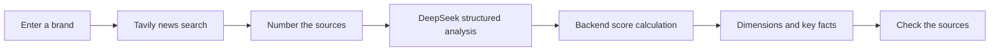

<div align="center">

# Green Lens

**English** · [中文](README.md)

### A consumer-facing prototype for ESG search and explanation

**From a brand name to three dimensions of analysis—and back to the sources.**

[Product case study (中文)](docs/case-study.md) · [Scoring design draft](docs/scoring-model.md) · [Quick start](#quick-start)

</div>


## What it helps users do

“I want to understand a brand's sustainability signals without reading a long report first.”

Enter a brand name. Green Lens retrieves ESG-related news and asks a model to analyze the summaries across environmental, social, and governance dimensions. It displays an overall score, key facts, and source links. The product explores **how fragmented information can become readable, traceable starting points for consumer decisions.**

| User task | What the current prototype offers |
| --- | --- |
| Get a quick introduction to a brand | Search by name or start with a suggested brand |
| Understand different dimensions | Separate E / S / G scores and tags |
| Understand the overall score | Fixed backend weights and a rating mapping |
| Find events worth reading about | Model-extracted positive and negative key facts |
| Continue checking the information | Numbered references and links to original coverage |



## Five decisions that make results easier to understand

### 01 Start with a brand name

Users do not need to learn ESG terminology first. Search is the main entry point; suggested brands make the first attempt easier. Loading, error, and result states communicate progress.

> **Try it:** Search for `Patagonia`, inspect the information retrieved in that run, and open a source behind a key fact. Results depend on current news and model output; this repository does not assign the brand a fixed, verified score.

### 02 Keep three dimensions alongside the total

Environmental, social, and governance signals can differ. A single label can hide those differences, so the interface retains dimension scores and tags to help users ask which events influenced a result.

The current implementation calculates:

```text
Overall = round(Environment × 30% + Social × 40% + Governance × 30%)
80 or above: Slay; 60–79: Meh; below 60: Sus
```

These are prototype product rules. The model still generates dimension scores; deterministic weights do not make the assessment externally certified.

### 03 Give key facts a route back to evidence

Retrieved summaries receive source numbers before entering the model. The prompt requires a `sourceIndex` for every key fact, which the results page uses to provide a source link. Reading a conclusion and checking it remain part of the same journey.

This currently relies on prompt instructions and frontend linking. Claim-level evidence verification, source credibility scoring, and brand disambiguation are not yet implemented. A working link alone does not establish support for every model judgment.

### 04 Separate AI analysis from deterministic calculation

The model extracts signals from summaries and produces dimension analysis. The backend calculates the total, maps the rating, and attaches source metadata. The fixed formula makes arithmetic inspectable; scoring quality requires separate evaluation.

| Stage | Current implementation |
| --- | --- |
| Retrieval | Tavily news search, with up to five results |
| Analysis | DeepSeek JSON output through an OpenAI-compatible SDK |
| Calculation | Backend weights of 30% / 40% / 30% |
| Presentation | Next.js and React display dimensions, facts, and links |

### 05 Make the next scoring design explicit

The [scoring design draft](docs/scoring-model.md) proposes layers for baseline ratings, recent events, and community feedback, including evidence, confidence, and sparse-data handling. **This is a future design and is not implemented in the current main flow.** Rankings, community voting, deep reports, and monetization are also not presented as shipped features.

## An end-to-end reading case

**Task:** Understand a brand's recent ESG signals.

1. Enter the brand and start a search.
2. Compare E / S / G results and identify the largest differences.
3. Read the relevant key facts and open the corresponding coverage.
4. Check the brand entity, event, date, and context.
5. Use the result to guide further reading; withhold judgment when evidence is insufficient.

**What can be checked:** Whether the flow returns structured results, the total follows the formula, and references correspond to their sources.

**What still needs validation:** Whether sources support each fact, repeated queries are stable, and users understand scoring limitations. See the [product case study (中文)](docs/case-study.md) for further tradeoffs.

## Quick start

```bash
npm install
```

Copy `.env.example` to `.env.local` and fill in your local credentials:

```dotenv
DEEPSEEK_API_KEY=<your-text-model-key>
TAVILY_API_KEY=<your-search-service-key>
```

```bash
npm run dev
```

Open the URL printed in the terminal, usually **http://localhost:3000**. Keep model and search credentials in server-side environment variables.

## Documentation and structure

| Entry | Contents |
| --- | --- |
| [Product case study (中文)](docs/case-study.md) | Problem framing, decisions, examples, and evaluation plans |
| [Scoring design draft](docs/scoring-model.md) | Future layered scoring, not fully implemented |
| [Analysis endpoint](app/api/analyze/route.ts) | Current retrieval, prompt, calculation, and response structure |
| [Results page](app/page.tsx) | Search, loading, dimensions, and sources |

```text
app/                  Search and results UI; analysis endpoint
lib/                  Data types and utilities
docs/                 Product case study and scoring draft
```

## Current boundaries

This is a search-augmented ESG analysis prototype. It has neither institutional rating data nor a validated brand benchmark database. Search coverage constrains the available news, model behavior affects dimension scores, and date handling needs improvement when publication dates are missing. Missing-dimension fallbacks, zero-score handling, and model JSON field validation also need work.

Next priorities are fact support, reference alignment, score stability, insufficient-evidence messaging, latency, and per-query cost. The repository does not provide measured user scale, retention, or improvements in decision quality.
