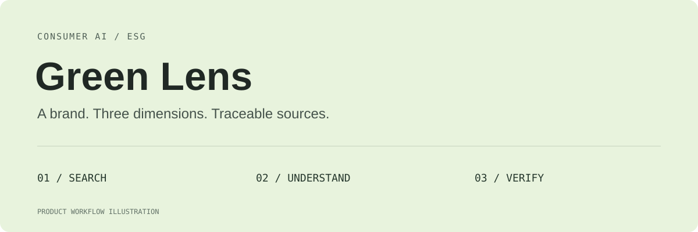
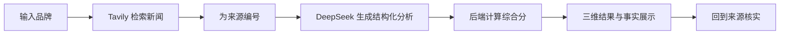

<div align="center">

# Green Lens

[English](README.md) · **中文**

### 面向消费者的 ESG 搜索与解释原型

**从一个品牌名，到三维分析，再回到事实来源。**

[产品案例](docs/case-study.md) · [评分设计草案](docs/scoring-model.md) · [快速启动](#快速启动)

</div>



## 它能帮用户做什么

“我想了解一个品牌的可持续表现，但不想先读完一份长报告。”

输入品牌名，Green Lens 检索相关 ESG 新闻，将摘要交给模型生成环境、社会、治理三个维度的分析，展示综合分、关键事实和来源入口。它探索的是：**怎样把分散的信息，变成消费者愿意阅读、能够回查的决策线索。**

| 用户要做的事 | 当前原型提供的帮助 |
| --- | --- |
| 快速了解品牌 | 输入品牌名，或从页面推荐品牌开始搜索 |
| 看懂不同维度 | 分开展示环境、社会、治理得分与标签 |
| 理解综合分 | 后端按固定权重合成总分并映射评级 |
| 找到值得关注的事件 | 展示模型提取的正面、负面关键事实 |
| 继续核实信息 | 通过来源编号和链接阅读原始报道 |



## 五个让结果更容易理解的设计

### 01　从品牌名开始，降低入口成本

用户无需先理解 ESG 术语。搜索是主入口，推荐品牌缩短首次尝试路径；加载、错误和结果状态让用户知道当前进度。

> **试一试：** 在搜索框输入 `Patagonia`，查看本次检索到哪些信息，再打开关键事实对应的来源。结果随新闻和模型输出变化，本仓库不预设该品牌的真实得分。

### 02　一个总分之外，保留三个维度

环境、社会、治理可能呈现不同信号，单一标签容易掩盖差异。页面保留各维度得分和标签，帮助用户继续追问“是哪一类事件影响了结果”。

当前实现按下面的方式合成总分：

```text
综合分 = 四舍五入（环境 × 30% + 社会 × 40% + 治理 × 30%）
80 分及以上：Slay；60–79 分：Meh；60 分以下：Sus
```

这是原型的产品规则。维度分仍由模型生成；固定计算权重并不代表评分已获得外部认证。

### 03　关键事实有回查入口

检索摘要进入模型前被编号，提示词要求每条关键事实返回 `sourceIndex`，结果页据此提供来源入口。这让“看到结论”与“继续核实”保持在同一条路径上。

目前是提示词约束与前端关联，尚未完成逐条事实蕴含校验、来源可信度打分或品牌消歧。能打开链接，不等于来源足以支撑模型的全部判断。

### 04　把 AI 分析和确定性计算分开

模型负责从新闻摘要提取线索、输出三维分析；后端负责总分计算、评级映射和来源列表拼接。评分公式固定，便于检查计算过程；评分质量仍需要单独评估。

| 环节 | 当前实现 |
| --- | --- |
| 检索 | Tavily 新闻搜索，最多返回 5 条结果 |
| 分析 | DeepSeek，通过 OpenAI 兼容 SDK 请求 JSON |
| 计算 | 后端按 30% / 40% / 30% 合成总分 |
| 展示 | Next.js + React，展示维度、关键事实与链接 |

### 05　把下一步评分设计单独写清楚

[评分设计草案](docs/scoring-model.md)提出“基础评分 + 近期事件 + 社区反馈”的分层方向，并讨论证据、置信度与数据不足时的处理。**这部分是后续方案，当前主流程尚未实现。** 排行榜、社区投票、深度报告和商业化也不作为已上线功能展示。

## 一个完整的阅读案例

**任务：** 用户想了解某品牌近期有哪些 ESG 信号。

1. 输入品牌，发起检索。
2. 查看 E / S / G 三维结果，找到差异最大的维度。
3. 阅读相关关键事实，打开对应新闻。
4. 核对报道是否提及同一品牌、同一事件，以及时间与上下文。
5. 将结果作为继续阅读的线索；信息不足时暂缓判断。

**可以验证：** 主流程能否返回结构化结果、总分是否符合公式、来源能否对应。

**仍需验证：** 事实是否被来源支持、重复查询是否稳定，以及用户能否理解评分局限。更多设计取舍见[产品案例](docs/case-study.md)。

## 快速启动

```bash
npm install
```

将 `.env.example` 复制为 `.env.local`，在本地填写：

```dotenv
DEEPSEEK_API_KEY=<你的文本模型密钥>
TAVILY_API_KEY=<你的检索服务密钥>
```

```bash
npm run dev
```

打开终端提示的地址，通常为 **http://localhost:3000**。模型和检索凭证保留在服务端环境变量中。

## 文档与目录

| 入口 | 内容 |
| --- | --- |
| [产品案例](docs/case-study.md) | 问题定义、设计取舍、示例与评估计划 |
| [评分设计草案](docs/scoring-model.md) | 分层评分的后续设计，尚未全部实现 |
| [分析接口](app/api/analyze/route.ts) | 当前检索、提示词、计算与返回结构 |
| [结果页面](app/page.tsx) | 搜索、加载、维度与来源展示 |

```text
app/                  搜索与结果页面、分析接口
lib/                  数据类型与工具
docs/                 产品案例与评分草案
```

## 当前边界

当前是搜索增强的 ESG 分析原型，没有机构级评级数据，也没有经过验证的品牌基准库。新闻覆盖受搜索结果限制；维度分受模型影响，来源日期缺失时的回填也需要改进。现有接口对缺失维度值的默认回退、零分处理及模型 JSON 字段校验仍需完善。

下一步优先验证事实支持率、引用对应率、评分稳定性、信息不足提示、响应耗时和单次成本。仓库尚未提供用户规模、留存或决策改善的实测数据。
